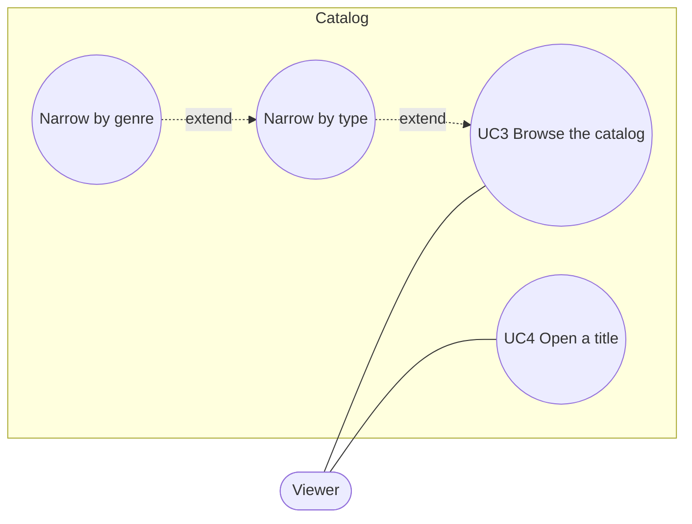

# Use case diagram — catalog

> **Feature**: UC3 Browse the catalog, UC4 Open a title ([spec](../../specs/catalog-grid.md))
> **Related ADRs**: ADR-0004

## Diagram

## Notes

- *Narrow by genre* extends *Narrow by type*: genre options exist only once a type is
  chosen (progressive disclosure, state diagram 05).
- *Watch a title* (UC5, #7) will extend UC4 from the detail dialog.
