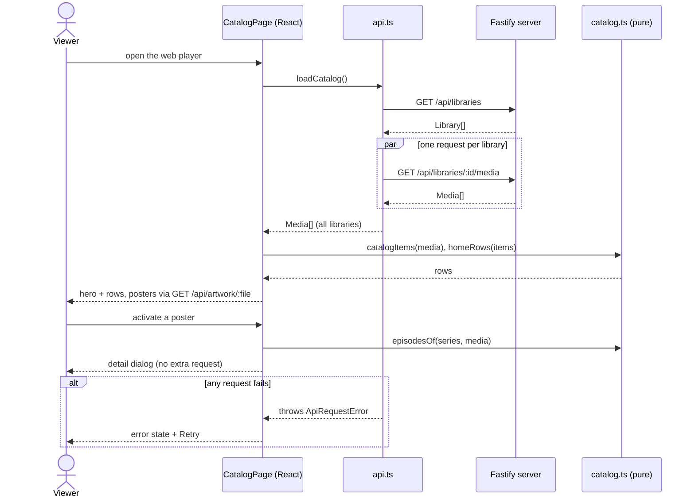

# Sequence diagram — catalog — load and open a title

> **Feature**: UC3 / UC4 ([spec](../../specs/catalog-grid.md))
> **Related ADRs**: ADR-0001, ADR-0004

## Diagram

## Notes

- All media are loaded once; type / view / genre changes are pure recomputations, no
  further request.
