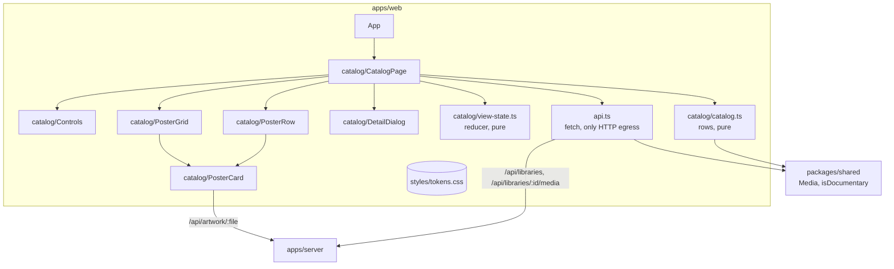

# Component diagram — catalog (apps/web)

> **Feature**: UC3 / UC4 ([spec](../../specs/catalog-grid.md))
> **Related ADRs**: ADR-0001, ADR-0004

## Diagram

## Notes

- Flat layout (architecture rule: no layers without a force): two pure modules hold all
  the logic and are unit-tested; components only render.
