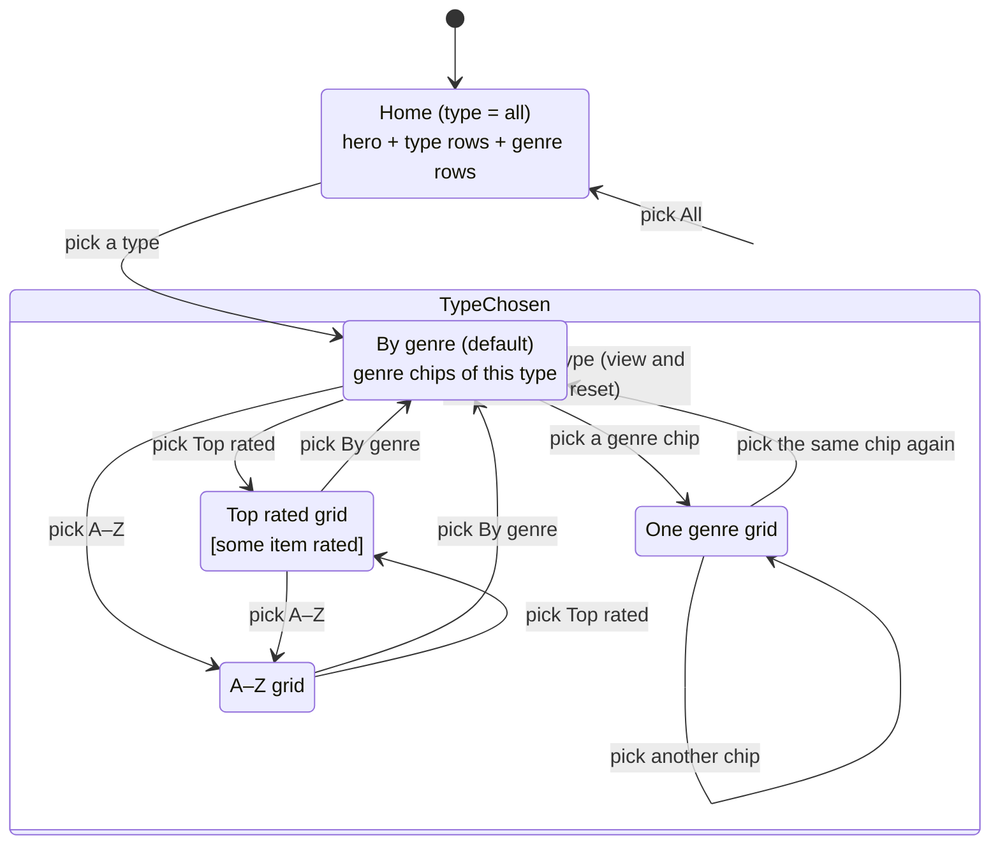

# State diagram — catalog — dynamic controls

> **Feature**: UC3 Browse the catalog ([spec](../../specs/catalog-grid.md))
> **Related ADRs**: ADR-0004

## Context

The owner wants controls whose options depend on the previous choice. The view state is
`{ type, view, genre }`; each choice resets the ones after it, and an option is only
rendered when it leads to a non-empty result.

## Diagram

## Notes

- Guards: a type tab exists only if the type has items; *Top rated* only if one of its
  items is rated; genre chips list only the genres of the chosen type.
- Implemented by the pure reducer `catalog/view-state.ts`; leaving a view clears `genre`.
