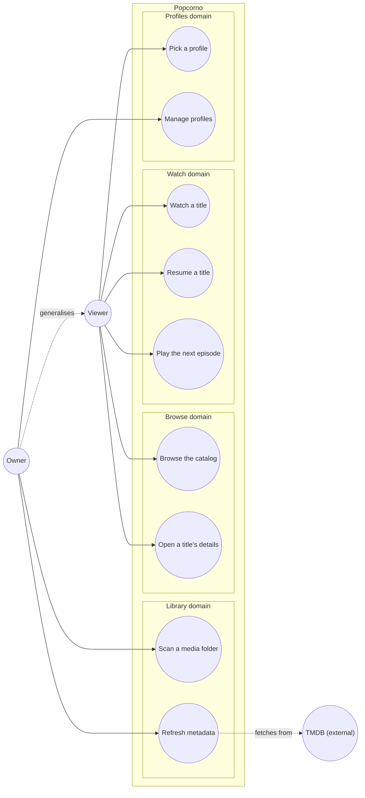

# Use case diagram — playback — MVP goals

> **Feature**: MVP v0.1.0 — [vision](../../../requirements/01-vision.md) § MVP scope
> **Related ADRs**: ADR-0001

## Context

Who wants what from Popcorno in the MVP. Grouped by domain (Library, Browse, Watch,
Profiles), never by the package that implements them. Does not show how the system is
structured — see `03-component.md`.

## Diagram

## Notes

- Owner generalises Viewer: the owner also browses and watches; only the owner's own
  goals are linked to Owner.
- UC6 and UC7 «extend» UC5 at the "playback ends / is reopened" extension points; kept as
  separate ovals for readability.
- UC2 is actor-initiated (the owner asks for a refresh); the scan's automatic metadata
  fetch is an «include» of UC1, not a use case of its own.
