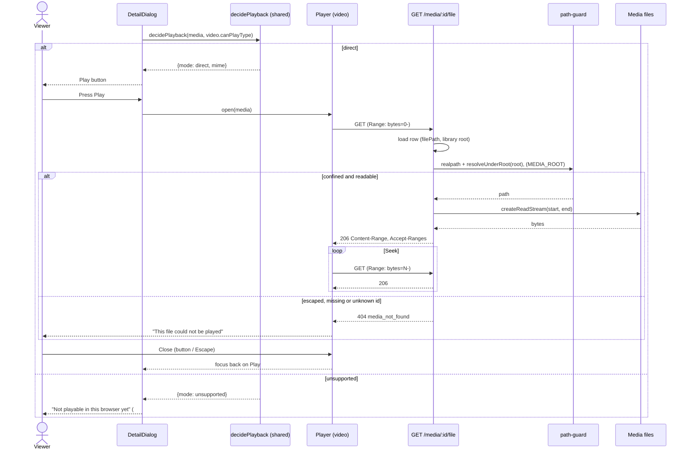

# Sequence diagram — playback — direct play (#7)

> **Feature**: UC5 Watch a title, direct branch — [spec](../../specs/direct-play.md)
> **Related ADRs**: ADR-0001, ADR-0005

## Context

Refines the *direct* branch of [watch a title](02-sequence-watch-a-title.md) for #7. Per
ADR-0005 the decision runs in the browser (it is the only place that knows its own
decoders); no playback session exists for direct play. #8 adds the session for HLS.

## Diagram

## Notes

- The id is a UUID validated by zod; it resolves to `media.file_path` (written by the scan).
- The guard is re-run per request: a root moved or a symlink swapped after the scan is
  caught (spec 4b).
