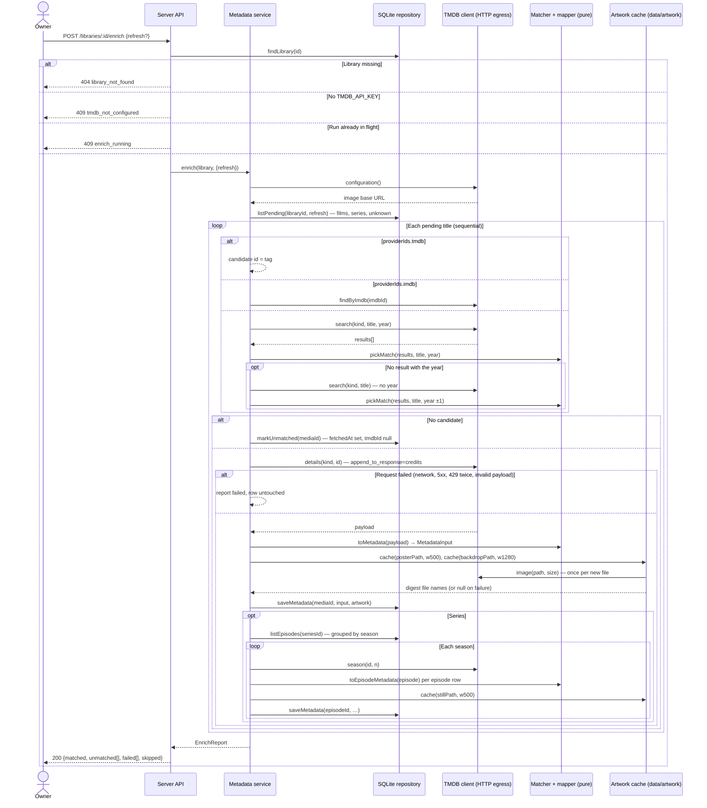

# Sequence diagram — playback — refresh metadata from TMDB (UC2)

> **Feature**: UC2 Refresh metadata — [use cases](01-use-case.md),
> [textual spec](../../specs/tmdb-metadata.md)
> **Related ADRs**: ADR-0001, ADR-0003

## Context

One title at a time: resolve a TMDB candidate (id tag, IMDb id or title + year), fetch
the details with the credits, map, cache the artwork, persist; for a series, one season
request per season present in the library. The same flow runs at the end of UC1 when a
key is configured (the «include»); the scanner itself never calls TMDB.

## Diagram

## Notes

- The TMDB client is the single HTTP egress of the server; it receives `fetch` by
  injection so tests assert URLs and headers without a socket. It adds the Bearer header
  and the `language` parameter, retries once on `429` after `Retry-After`, and strips the
  key from any error it throws.
- Only `query` (title), `year` / `first_air_date_year` and a provider id ever appear in a
  request (data-flow 06).
- Matcher and mapper are pure: fixtures in, typed values out, no I/O.
- The artwork cache validates the TMDB path before building a URL and names files by the
  SHA-256 of that path; the serving route (`GET /artwork/:file`) accepts digests only.
- Failures are per title: the report lists them, the run continues, the scan that
  included the run still returns `200`.
