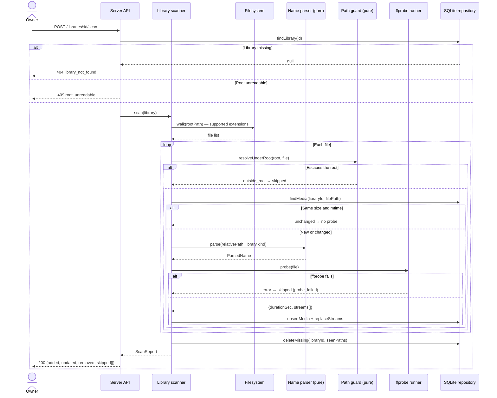

# Sequence diagram — playback — scan a media folder (UC1)

> **Feature**: UC1 Scan a media folder — [use cases](01-use-case.md),
> [textual spec](../../specs/library-scan.md)
> **Related ADRs**: ADR-0001, ADR-0002

## Context

Filesystem walk, pure parsing, one `ffprobe` per new file, persistence. Shows where the
boundaries are (fs, process, SQLite) and where the pure domain sits (parser, path guard).

## Diagram

## Notes

- The name parser and the path guard are pure functions: unit-tested without fs or
  process mocks.
- The `ffprobe runner` is the single process egress (component diagram); the scanner
  receives it as a dependency so tests inject a fake.
- Probing only new or changed files keeps a re-scan cheap; the check is size + mtime,
  not a content hash (good enough for the owner's own files).
