# Sequence diagram — playback — watch a title (direct play or HLS transcode)

> **Feature**: UC5 Watch a title — [use cases](01-use-case.md),
> [spec HLS](../../specs/hls-transcode.md), [spec direct](../../specs/direct-play.md)
> **Related ADRs**: ADR-0001, ADR-0005, ADR-0006

## Context

Every Play goes through `POST /playback/sessions`: the server confirms direct play with
`directPlayMime` or starts an HLS session. Resume (UC6) will only add a start offset.

## Diagram

```mermaid
sequenceDiagram
  actor V as Viewer
  participant W as Web player
  participant API as Session routes
  participant SM as SessionManager
  participant TR as Transcoder
  participant FF as FFmpeg (child process)
  participant FS as Session temp dir

  V->>W: Press Play
  W->>W: decidePlayback(media, canPlayType)
  W->>API: POST /playback/sessions {mediaId, directPlay}
  API->>API: find media (404 media_not_found)
  alt directPlay and directPlayMime(media) ≠ null
    API-->>W: 200 {mode: direct, url: /media/:id/file}
    W->>API: GET /media/:id/file (Range) — #7 flow, path guard there
  else HLS
    API->>API: path guard on the stored path (404 media_not_found)
    API->>SM: open(realPath, streams)
    alt TRANSCODE_MAX_SESSIONS reached (counted before any await)
      SM-->>API: busy
      API-->>W: 503 transcode_busy
    else no video stream
      SM-->>API: not_playable
      API-->>W: 422 not_playable
    else slot free
      SM->>FS: mkdtemp
      SM->>TR: run(ffmpegArgs(realPath, streams, dir))
      TR->>FF: spawn (no shell, -i path)
      FF->>FS: index.m3u8, segment-00000.ts …
      SM->>FS: wait for index.m3u8 (≤ 20 s)
      alt playlist written
        SM-->>API: session
        API-->>W: 201 {mode: hls, sessionId, url}
        W->>W: import('hls.js'), attach to <video>
        loop while playing
          W->>API: GET /playback/sessions/:id/index.m3u8 | segment-NNNNN.ts
          API->>SM: touch(id) (idle timer reset)
          API->>FS: read file
          API-->>W: 200
        end
        loop every 20 s while the player is open
          W->>API: POST /playback/sessions/:id/heartbeat
          API->>SM: touch(id)
          API-->>W: 204
        end
      else ffmpeg exited / timeout
        SM->>FF: kill
        SM->>FS: rm -r
        API-->>W: 502 transcode_failed
      end
    end
  end
  alt Viewer closes the player
    W->>API: DELETE /playback/sessions/:id
    API->>SM: close(id)
  else 60 s without any request
    SM->>SM: watchdog fires close(id)
  end
  SM->>FF: kill (SIGKILL)
  SM->>FS: rm -r
```

## Notes

- `ffmpegArgs` is pure; `Transcoder` is the only child-process egress of the playback
  domain and gets `spawn` injected (tests never run FFmpeg).
- Playlist and segment routes never build a path from the URL without validating the
  name (`index.m3u8` or `segment-\d{5}.ts`) and joining it to the session's own dir.
- Direct play keeps the #7 Range route untouched.
