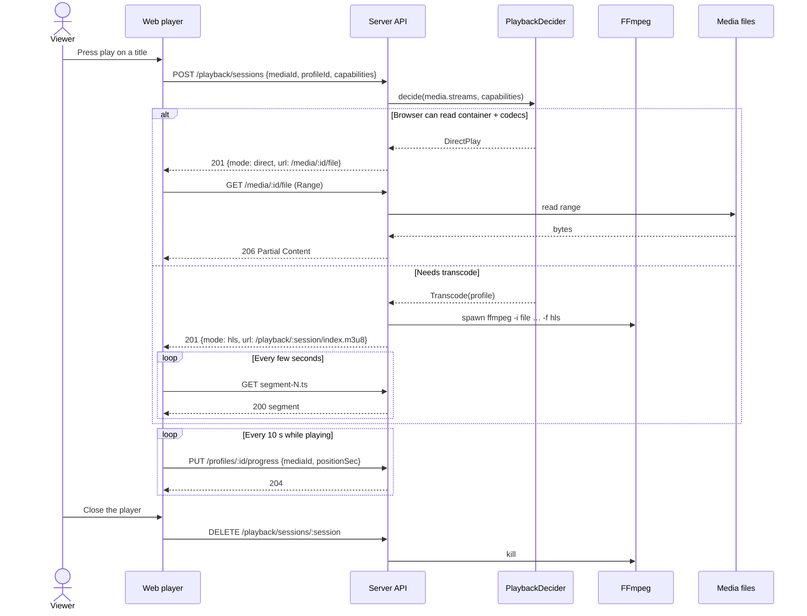

# Sequence diagram — playback — watch a title (direct play or HLS transcode)

> **Feature**: UC5 Watch a title — [use cases](01-use-case.md)
> **Related ADRs**: ADR-0001

## Context

The one non-trivial flow of the MVP: deciding between direct play and transcode, and
streaming either. Resume (UC6) only changes the initial `startAt`.

## Diagram

## Notes

- `PlaybackDecider` is pure domain code: streams + capabilities in, decision out. It is
  the first unit-test target.
- The Range path never touches FFmpeg; the HLS path never touches Range.
- Session deletion kills the FFmpeg child; a watchdog also kills sessions idle > 60 s.
- Path safety: `/media/:id/file` resolves the id to a path stored at scan time, never a
  client-supplied path.
