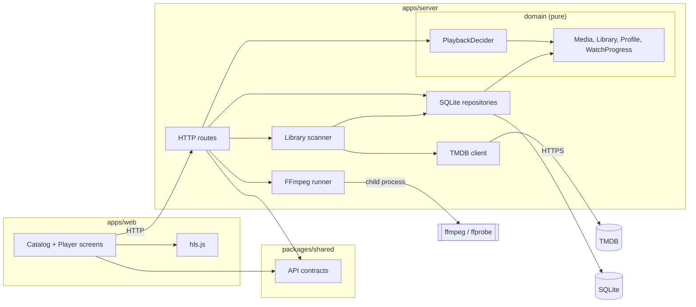

# Component diagram — playback — system structure

> **Feature**: MVP v0.1.0
> **Related ADRs**: ADR-0001

## Context

How the system is split and who depends on whom. The dependency rule holds: the domain
(decider, entities) imports nothing from Fastify, Drizzle, FFmpeg or the filesystem.

## Diagram

## Notes

- Flat layering on purpose: routes call the domain and the adapters directly. A ports
  layer appears only when a second implementation exists (e.g. a second metadata
  provider).
- `FFmpeg runner` is the single egress to the process API; nothing else spawns processes.
