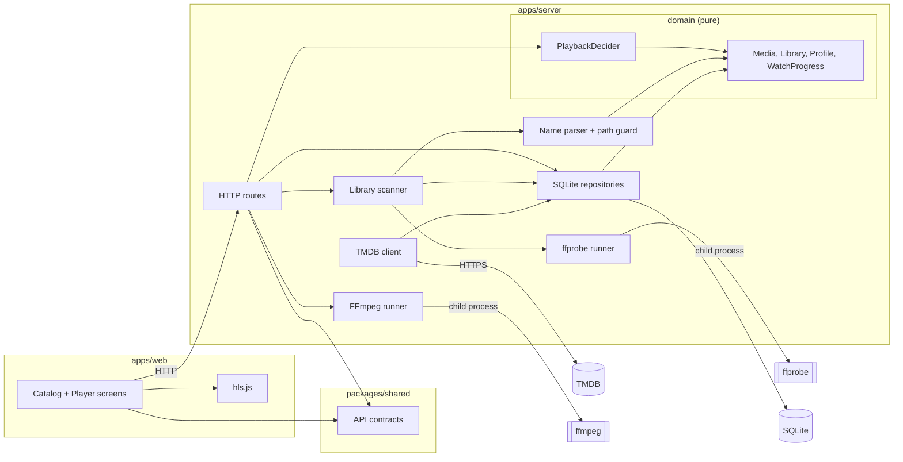

# Component diagram — playback — system structure

> **Feature**: MVP v0.1.0
> **Related ADRs**: ADR-0001

## Context

How the system is split and who depends on whom. The dependency rule holds: the domain
(decider, entities) imports nothing from Fastify, Drizzle, FFmpeg or the filesystem.

## Diagram

## Notes

- Flat layering on purpose: routes call the domain and the adapters directly. A ports
  layer appears only when a second implementation exists (e.g. a second metadata
  provider).
- The two runners are the only egress to the process API; nothing else spawns processes.
  The scanner receives the `ffprobe runner` as a function (`Prober`) so tests inject a
  fake. `Name parser + path guard` are pure (no fs, no process). The TMDB client (#4)
  enriches rows the scanner stored; the scanner does not call it.
