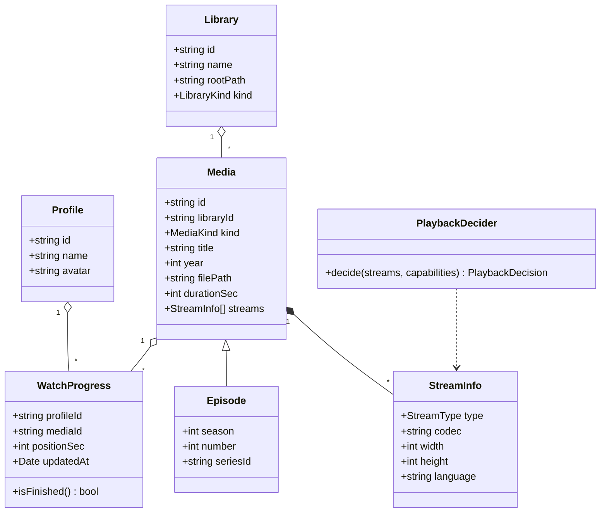

# Class diagram — playback — domain entities

> **Feature**: MVP v0.1.0
> **Related ADRs**: ADR-0001

## Context

The domain model shared by scan, browse and watch. Persistence shape (tables) derives
from it, not the reverse.

## Diagram

## Notes

- `Episode` extends `Media` with its position in a series; a series is a `Media` of kind
  `series` with no file of its own.
- `WatchProgress.isFinished()` = position ≥ 90 % of duration; drives "next episode".
- `PlaybackDecider` has no state; it is a function in a class box for UML readability.
