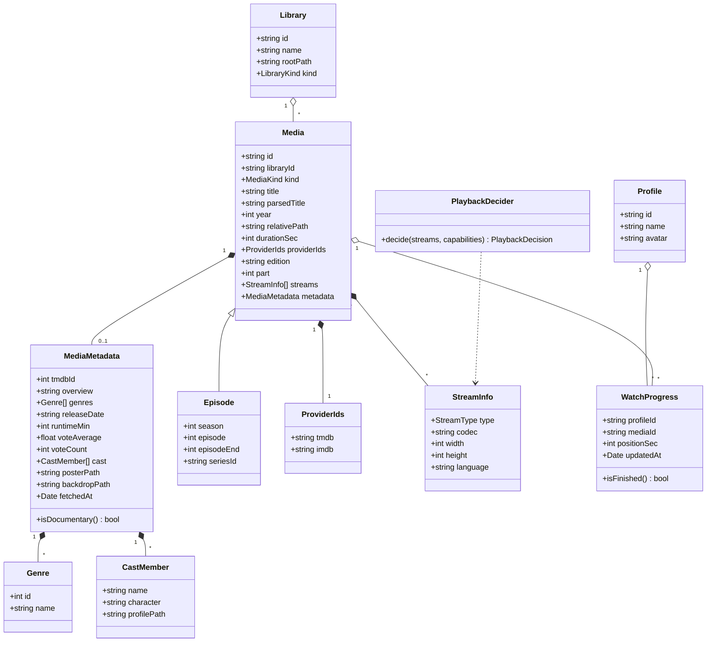

# Class diagram — playback — domain entities

> **Feature**: MVP v0.1.0
> **Related ADRs**: ADR-0001

## Context

The domain model shared by scan, browse and watch. Persistence shape (tables) derives
from it, not the reverse.

## Diagram

## Notes

- `Episode` extends `Media` with its position in a series (`episodeEnd` for a
  multi-episode file); a series is a `Media` of kind `series` with no file of its own.
- `relativePath` is what the API exposes; the real absolute path, the size and the
  mtime live only in the `media` table (playback and re-scan fingerprint).
- `providerIds`, `edition` and `part` come from the Plex / Jellyfin file-name tags
  (spec UC1); `providerIds` is the hand-off to TMDB (UC2).
- `MediaMetadata` (UC2, ADR-0003) is null until TMDB was asked; `fetchedAt` set with
  `tmdbId` null means "looked up, unmatched". `posterPath` / `backdropPath` are cached
  file names under `data/artwork` (served by `GET /artwork/:file`), never TMDB URLs; for
  an episode `posterPath` holds the still. `isDocumentary()` = genre id 99 present: the
  catalog's "documentaries" row is derived, `kind` stays structural. Persisted as columns
  on `media` with `genres` / `cast` as JSON.
- `WatchProgress.isFinished()` = position ≥ 90 % of a known duration; drives "next
  episode" (UC7). Until profiles exist (#10) every row has `profileId = 'default'`
  (ADR-0007 §1); persisted in `watch_progress`, key `(profile_id, media_id)`.
- `PlaybackDecider` has no state; it is a function in a class box for UML readability.
