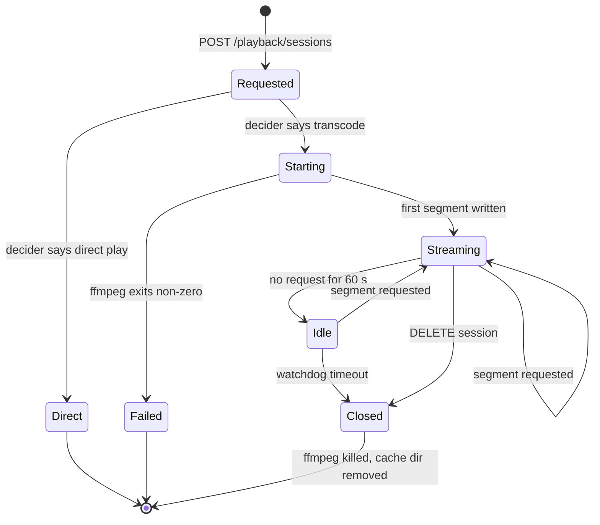

# State diagram — playback — PlaybackSession lifecycle

> **Feature**: UC5 Watch a title
> **Related ADRs**: ADR-0001

## Context

A server-side playback session exists only for transcoded playback (direct play is
stateless Range serving). Its lifecycle bounds the FFmpeg process.

## Diagram

## Notes

- `Direct` terminates immediately: the session record is only an audit line.
- `Idle → Closed` is the safety net against players that never send DELETE (tab closed).
