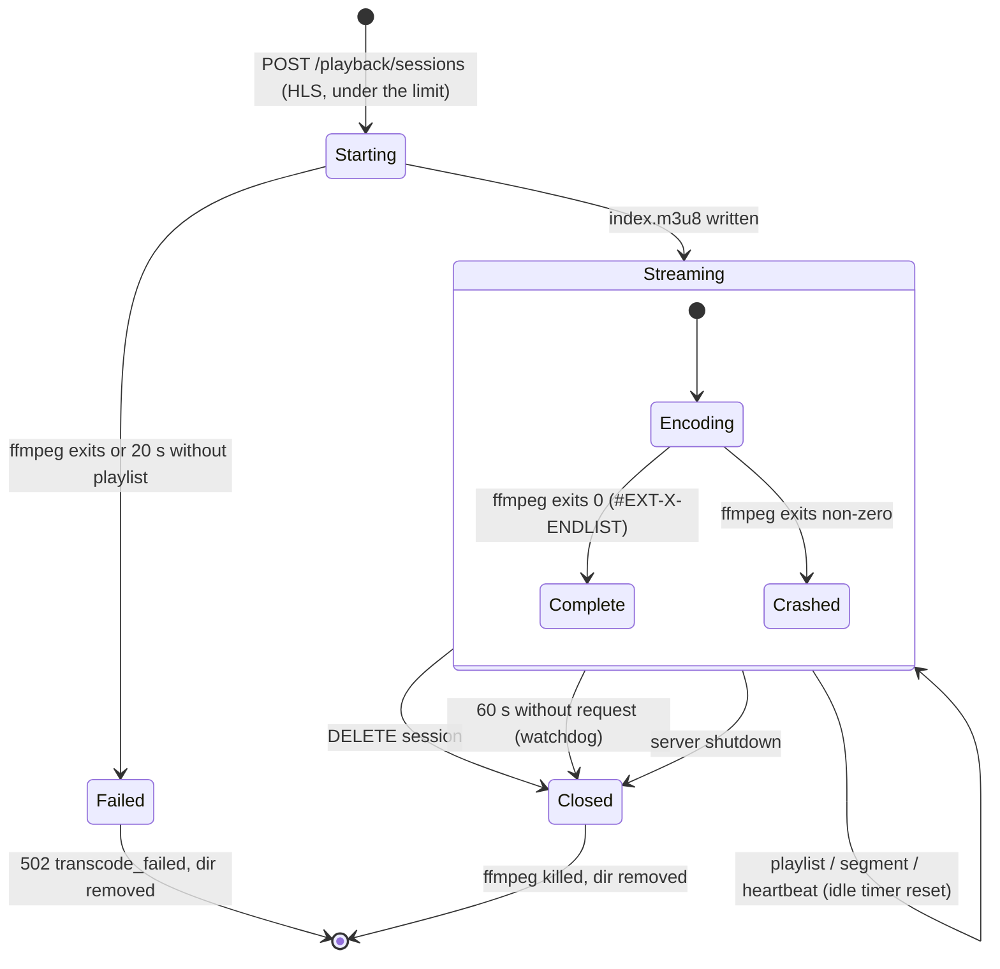

# State diagram — playback — PlaybackSession lifecycle

> **Feature**: UC5 Watch a title — [spec](../../specs/hls-transcode.md)
> **Related ADRs**: ADR-0001, ADR-0006

## Context

A server-side session exists only for HLS playback (direct play is stateless Range
serving). It lives in memory in the `SessionManager` and bounds one FFmpeg process and
one temp directory.

## Diagram

## Notes

- Once `Closed`, the id is forgotten: later requests get `404 session_not_found`.
- `Complete` and `Crashed` keep serving what was written; a crash surfaces in the
  player through hls.js when a missing segment is requested.
- The heartbeat (every 20 s from the open player) keeps a paused session alive; a closed
  tab stops it and the watchdog cleans up.
- `Failed` and `Closed` free a slot of `TRANSCODE_MAX_SESSIONS`.
