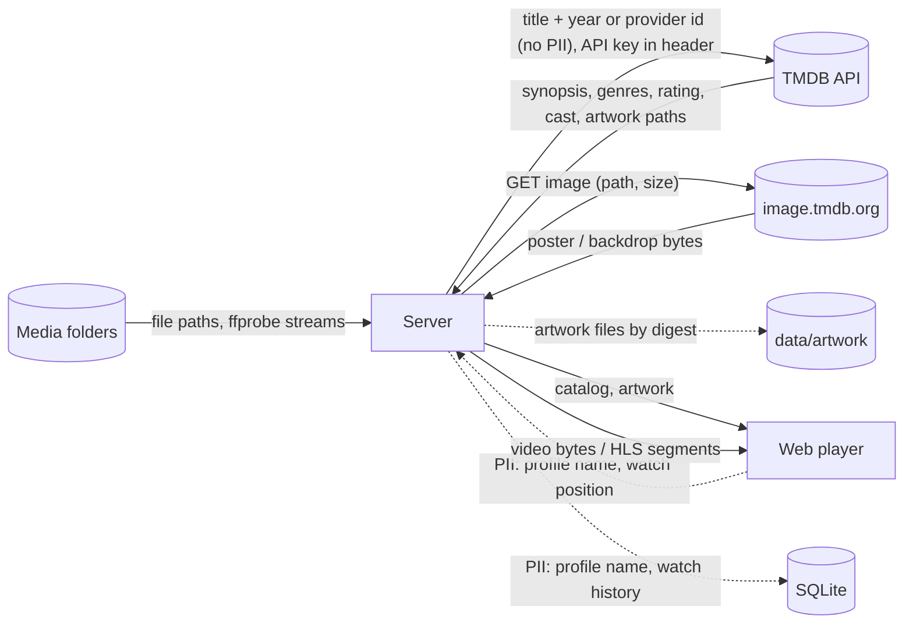

# Data-flow diagram — playback — what goes where

> **Feature**: MVP v0.1.0
> **Related ADRs**: ADR-0001

## Context

Which data crosses which boundary, with personal data flagged. The only PII in the MVP
is the profile name and the watch history, and neither leaves the server.

## Diagram

## Notes

- TMDB only ever receives a title and a year (or the provider id read from the file
  name) plus the owner's API key in the `Authorization` header, never who is watching.
  The key is never logged nor echoed in an error (ADR-0003).
- Watch history stays in the local SQLite file; no telemetry, no cloud sync.
- Artwork is cached on disk under `data/artwork` (file name = SHA-256 of the TMDB path)
  and served by the server (`GET /artwork/:file`): the web player never contacts
  TMDB, so no viewer IP leaves the home network. Cast photos are not cached in the MVP
  and therefore not shown (follow-up).
