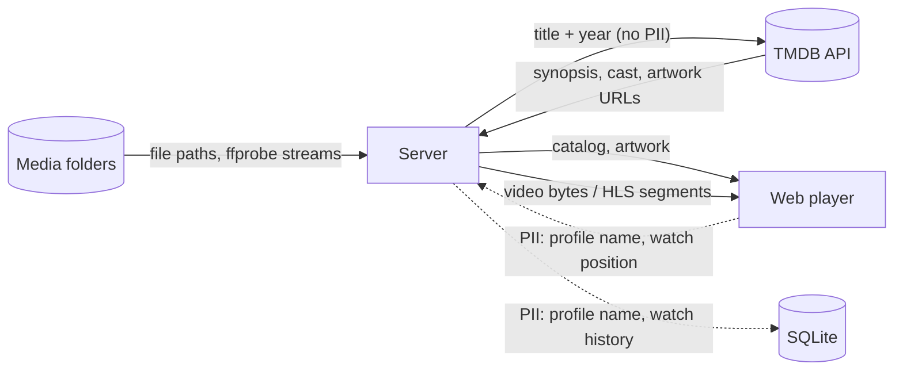

# Data-flow diagram — playback — what goes where

> **Feature**: MVP v0.1.0
> **Related ADRs**: ADR-0001

## Context

Which data crosses which boundary, with personal data flagged. The only PII in the MVP
is the profile name and the watch history, and neither leaves the server.

## Diagram

## Notes

- TMDB only ever receives a title and a year, never who is watching.
- Watch history stays in the local SQLite file; no telemetry, no cloud sync.
- Artwork is cached on disk under `data/` so TMDB is not hit on every page load.
